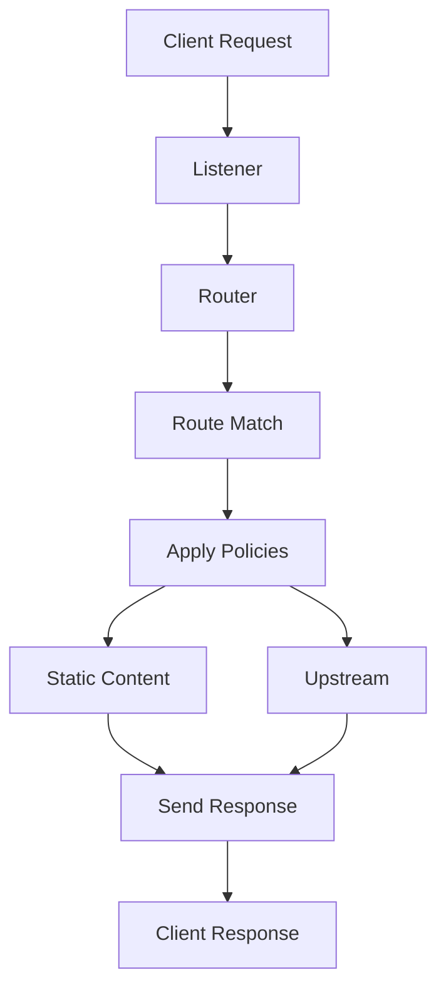

<div align="center">
  
  <br />
  <br />
  <h1>🛡️ Ophan API Gateway</h1>
  <p>
    <b>A lightweight, high-performance api gateway</b>
    <br />
    built on <a href="https://github.com/cloudflare/pingora">Cloudflare Pingora</a>
  </p>
  <p>
    
    
    
  </p>
  <br />
</div>

---

> ⚠️ **DISCLAIMER** — Ophan is under **active development**. APIs, config formats, and behavior may change without notice.  
> It is **not recommended for production use** at this stage. Feedback and contributions are welcome.

---

## 📚 Documentation

The full documentation site is hosted on GitHub Pages:

<https://zsweiter.github.io/ophan/>

---

## 📬 Feedback

Found a bug? Have a suggestion? Reach out:

📧 **zsweiter@gmail.com**

We're early-stage and every piece of feedback helps shape the roadmap.

---

## 🔥 Features

Ophan combines reverse proxy, API gateway, load balancer, and static content delivery into a single modular platform.

| Layer          | Capabilities                                       |
| -------------- | -------------------------------------------------- |
| **Protocols**  | HTTP/1.1, HTTP/2, WebSocket, gRPC                  |
| **Security**   | TLS termination, mTLS, JWT / OAuth2, WAF           |
| **Traffic**    | Rate limiting, CORS, URL rewriting, load balancing |
| **Resilience** | Health checks, circuit breaking, hot reload        |
| **Delivery**   | Static file serving,                               |
| **Transport**  | TCP, Unix Domain Sockets                           |

---

## 📦 Installation

### Linux / macOS — Quick script

```bash
# Latest release
curl -fsSL https://raw.githubusercontent.com/zsweiter/ophan/main/scripts/install.sh | sudo bash
```

```bash
# Specific version
curl -sSL https://raw.githubusercontent.com/zsweiter/ophan/main/scripts/install.sh | sudo bash -s -- --version v0.1.0
```

### Debian / Ubuntu — .deb

Static packages for `amd64` and `arm64`, attached to every release; they run on any Debian or
Ubuntu release.

```bash
VERSION=0.1.32
ARCH=$(dpkg --print-architecture)      # amd64 or arm64
curl -fLO "https://github.com/zsweiter/ophan/releases/download/v${VERSION}/ophan_${VERSION}_${ARCH}.deb"
sudo apt install "./ophan_${VERSION}_${ARCH}.deb"

# The service is enabled but not started, so it does not take port 80 by surprise
sudo systemctl start ophan
```

The configuration lives in `/etc/ophan` and is kept on upgrades. Installing a newer `.deb` the
same way upgrades without downtime: the running gateway hands its listeners over to the new
binary.

### Upgrade

Binaries installed from the tarball or the install script update themselves:

```bash
sudo ophan --upgrade             # latest release
sudo ophan --upgrade 0.1.32      # a given version
```

It downloads the release for this platform, verifies its SHA-256, checks that the new binary
accepts the current configuration and replaces the binary atomically (the previous one stays as
`ophan.old`). Then it reloads the running instance, which hands its listeners over to the new
binary without dropping connections. `latest` never installs an older version. Installations
managed by dpkg, Homebrew or a container image are left to those tools.

### Linux / macOS — Manual

```bash
# Download
VERSION="v0.1.0"
OS="linux"          # or "macos"
ARCH="x86_64"       # or "aarch64"
curl -sSL "https://github.com/zsweiter/ophan/releases/download/${VERSION}/ophan-${VERSION#v}-${OS}-${ARCH}.tar.gz" -o ophan.tar.gz

# Extract
tar -xzf ophan.tar.gz

# Install binary
sudo mv ophan-*/ophan /usr/local/bin/

# Install config
sudo mkdir -p /etc/ophan
sudo cp -r ophan-*/config/* /etc/ophan/

# Install web assets (served by the gateway on /)
sudo mkdir -p /var/www/html
sudo cp ophan-*/config/public/index.html ophan-*/config/public/favicon.svg /var/www/html/

# Install service (Linux)
# The stub contains @SBINDIR@/@CONFIGDIR@ placeholders — substitute them first
sudo sed -e 's|@SBINDIR@|/usr/local/bin|g' -e 's|@CONFIGDIR@|/etc/ophan|g' \
    ophan-*/stubs/systemd.service | \
    sudo tee /etc/systemd/system/ophan.service > /dev/null
sudo systemctl daemon-reload
sudo systemctl enable --now ophan

# Install service (macOS)
sudo sed -e 's|@SBINDIR@|/usr/local/bin|g' -e 's|@CONFIGDIR@|/etc/ophan|g' \
    ophan-*/stubs/io.ophan.ophan.plist | \
    sudo tee /Library/LaunchDaemons/io.ophan.ophan.plist > /dev/null
sudo launchctl bootstrap system /Library/LaunchDaemons/io.ophan.ophan.plist
```

### Docker

Images are built by CI and published to **GitHub Packages** (GHCR) for `linux/amd64` and `linux/arm64`:

- `ghcr.io/zsweiter/ophan:latest` — every push to `main` / `develop`
- `ghcr.io/zsweiter/ophan:<version>` — every release tag (`v1.2.3` → `1.2.3`, `1.2`)
- `ghcr.io/zsweiter/ophan:sha-<commit>` — per-commit image

```bash
# Pull
docker pull ghcr.io/zsweiter/ophan:latest

# Run with the default config: HTTP on port 80 and a unix socket in the /run/ophan volume
docker run -d --name ophan -p 8080:80 ghcr.io/zsweiter/ophan:latest

# Run with your own config directory
docker run -d --name ophan -p 8080:80 \
  -v /path/to/config:/etc/ophan \
  ghcr.io/zsweiter/ophan:latest
```

The image is built on `gcr.io/distroless/static-debian12:nonroot`: the static binary, CA
certificates and the default configuration, with no shell or package manager. It runs as the
`nonroot` user (uid/gid `65532`) and binds ports below 1024 through the `cap_net_bind_service`
file capability.

Like the nginx image, only port 80 is exposed. The default gateway serves `/var/www` on port 80
and on the unix socket `/run/ophan/ophan_gateway.sock`; add a TLS listener in your own config and
publish 443 when the gateway terminates TLS itself.

When `/etc/ophan` is mounted empty, the gateway copies the default configuration into it before
starting. Arguments are passed to the binary:

```bash
# Validate a configuration
docker run --rm -v ./config:/etc/ophan ghcr.io/zsweiter/ophan:latest -t -c /etc/ophan/master.conf
```

| Variable                | Default                   | Purpose                                         |
| ----------------------- | ------------------------- | ----------------------------------------------- |
| `CONFIG_PATH`           | `/etc/ophan/master.conf`  | Configuration file                              |
| `OPHAN_CONFIG_SEED_DIR` | `/usr/share/ophan/config` | Defaults copied when the configuration is missing |
| `OPHAN_PID_FILE`        | `/tmp/ophan/ophan.pid`    | PID file                                        |

#### Volumes

| Container path   | Why                                                                          |
| ---------------- | ---------------------------------------------------------------------------- |
| `/etc/ophan`     | `master.conf` + `gateways/*.conf`. Seeded from the image when mounted empty. |
| `/var/www`       | Static content served by `backend = static(...)`.                            |
| `/var/log/ophan` | Log files, if the config writes there.                                       |
| `/run/ophan`     | Unix sockets shared with a proxy in another container or on the host.        |

The PID file and the upgrade socket live in `/tmp/ophan`, so `/run/ophan` only holds the
listener sockets; a socket left by a previous container is replaced when the gateway starts.

> Named volumes take the image's ownership (`65532`). For host bind mounts, give the directory
> to that uid first: `sudo install -d -o 65532 -g 65532 ./logs`.

#### Networking

Two modes are supported — pick per use case:

**1. Bridge network (default)** — isolated container network, ports published explicitly:

```bash
docker run -d --name ophan \
  -p 80:80 -p 443:443 \
  -v ./config:/etc/ophan \
  ghcr.io/zsweiter/ophan:latest
```

**2. Host network** — no port publishing, the container shares the host's NICs.
**Required for XDP/eBPF filtering** (image built with `ENABLE_XDP=1`): XDP attaches
directly to a host network interface, which is meaningless behind bridge NAT.
Also convenient when the gateway should own host ports 80/443 directly:

```bash
docker run -d --name ophan \
  --network host \
  --cap-add NET_ADMIN --cap-add BPF --cap-add PERFMON \
  -v ./config:/etc/ophan \
  ghcr.io/zsweiter/ophan:latest
```

> The default CI image is built **without** XDP (`ENABLE_XDP` is unset). Treat
> `--network host` + capabilities as the "no isolation" mode; without XDP it is
> simply a shortcut for binding ports 80/443 on the host without `-p`.
>
> Host network does **not** share the filesystem: a unix socket created inside
> the container is still invisible to host processes until you bind-mount its
> directory (see below).

#### Unix domain socket

Ophan can listen on a unix socket instead of TCP — useful for traffic that must
never be reachable over the network (internal service mesh hop, sidecar proxy,
or a [Cloudflare Tunnel](https://developers.cloudflare.com/cloudflare-one/connections/connect-networks/)
origin). The image's default gateway already has one:

```conf
listeners {
    listener "http" {
        address   = "0.0.0.0:80"
        protocols = ["http1", "http2"]
    }

    # same path inside the container and on the host (bind-mounted dir)
    listener "uds" {
        address     = "unix:/run/ophan/ophan_gateway.sock"
        protocols   = ["http1", "http2"]   # TLS is not supported on UDS
        permissions = "0666"               # any process that can reach the socket file may connect

        # A unix socket has no peer address: the proxy in front must send the client address.
        trusted_proxies {
            real_ip_header = "X-Forwarded-For"   # "CF-Connecting-IP" for cloudflared only
        }
    }
}
```

Requests on the socket without a valid client address header get `400`.

**cloudflared on bare metal** — nothing is exposed on TCP except the tunnel
itself. The socket must land on the *host* filesystem, so mount a dedicated
host directory into the container:

```bash
# 1. host directory owned by the image's nonroot user
sudo install -d -o 65532 -g 65532 -m 755 /run/ophan

# 2. run the gateway (bridge network is enough — the socket travels through
#    the bind mount, not through the network)
docker run -d --name ophan \
  -v ./config:/etc/ophan \
  -v /run/ophan:/run/ophan \
  ghcr.io/zsweiter/ophan:latest
```

```yaml
# /etc/cloudflared/config.yml (host-installed cloudflared, systemd service)
tunnel: <TUNNEL_ID>
credentials-file: /etc/cloudflared/<TUNNEL_ID>.json

ingress:
  - hostname: api.example.com
    service: unix:/run/ophan/ophan_gateway.sock   # HTTP over the host-visible socket
  - service: http_status:404                          # required catch-all
```

Notes:

- **Path symmetry** — the dir is mounted at the same path on both sides, so
  ophan's config and cloudflared's `service` use the identical string. If the
  paths differ, use the *container* path in ophan's config and the *host* path
  in cloudflared — they point at the same inode.
- **Permissions to connect** — `permissions` sets the socket mode. The default
  `0666` lets any process that can reach the file connect, whatever its uid
  (nginx runs as `101`, cloudflared as `65532`); restrict it to `0660` when the
  proxy shares uid or gid `65532`.
- **Bridge vs host network** — not needed for the socket. Use `--network host`
  only if you want XDP/eBPF filtering or TCP listeners bound directly on the
  host without publishing ports.
- If the mounted directory is not writable by uid `65532`, the listener fails to
  bind and the gateway logs the error at start.

> If the proxy were a container instead, share the directory with a named
> volume (`-v ophan-run:/run/ophan` on **both** services) and point
> cloudflared at `unix:/run/ophan/ophan_gateway.sock`.

#### Building the image locally

```bash
# Single-arch, loaded into the local daemon
make package-docker

# Multi-arch, pushed to GitHub Packages (same flow as CI)
docker buildx build --platform linux/amd64,linux/arm64 \
  -t ghcr.io/zsweiter/ophan:latest --push .
```

### Verify checksums

Every release includes SHA256 checksums:

```bash
# After downloading a package
sha256sum -c ophan-*.tar.gz.sha256

# Or download the matching checksum for the exact package, e.g.
curl -sSL https://github.com/zsweiter/ophan/releases/download/v0.1.0/ophan-v0.1.0-linux-x86_64.tar.gz.sha256
```

---

## 🗑️ Uninstall

### Linux (systemd)

```bash
sudo systemctl stop ophan
sudo systemctl disable ophan
sudo rm -f /etc/systemd/system/ophan.service
sudo rm -f /usr/local/bin/ophan
sudo rm -rf /etc/ophan
sudo rm -rf /var/log/ophan
sudo rm -rf /run/ophan
sudo userdel ophan
# Remove the web assets only if no other site is using /var/www/html
sudo rm -f /var/www/html/index.html /var/www/html/favicon.svg
sudo systemctl daemon-reload
```

### macOS (LaunchDaemon)

```bash
sudo launchctl bootout system /Library/LaunchDaemons/io.ophan.ophan.plist
sudo rm -f /Library/LaunchDaemons/io.ophan.ophan.plist
sudo rm -f /usr/local/bin/ophan
sudo rm -rf /etc/ophan /var/log/ophan /var/run/ophan
```

### Windows

```powershell
# Remove the service (the stub script supports install | uninstall | status)
.\stubs\windows-service.ps1 -Action uninstall
```

---

## 🏗️ High-Level Architecture



---

## 🔁 Middleware Pipeline

```
request
  → tls termination
  → cors
  → waf
  → rate limit
  → auth (oauth2 / jwt)
  → rewrite
  → route
  → static / upstream proxy
  → response
```

---

## 🧭 Vision

- **Simplicity** — Declarative config, minimal moving parts
- **Performance** — Allocation-free routing, lock-free hot path, upstream connection reuse by default
- **Hot Reload** — Atomic config swap without dropping connections
- **Modular** — Plug policies, backends, and protocols

---

## 🛠️ Development

```bash
make fmt
make lint
make test
make run
```

### CI pipeline

```bash
make ci          # fmt → lint → test → package (auto-detect OS)
make package-all # Build + package for Linux, macOS, Windows
make package-docker  # Build Docker image (musl)
make checksum    # Generate SHA256 checksums
```

### Benchmarking

`scripts/benchperf.sh` measures ophan head-to-head against an equally
configured nginx on the same port (never concurrently): static 1 KiB / 100 KiB
files, a reverse-proxy pass-through and a pure route-matched path. It reports
RPS, latency p50/p90/p99 (hey) plus CPU% and RSS of the whole process tree.

```bash
apt install hey                   # load generator (or: go install github.com/rakyll/hey@latest)
make build
scripts/benchperf.sh              # 10 s per scenario, keep-alive
scripts/benchperf.sh --rate 20000 --duration 10 --scenarios static_1k,proxy --no-nginx
```

### GitHub workflows

| Workflow        | Trigger                           | What it does                                   |
| --------------- | --------------------------------- | ---------------------------------------------- |
| `ci.yml`        | push / PR                         | fmt → clippy → tests (4 targets)               |
| `release.yml`   | tag `vX.Y.Z`                      | release tarballs/zips + SHA256 checksums       |
| `docker.yml`    | push to `main`/`develop`, tag, PR | multi-arch image → GitHub Packages (`ghcr.io`) |
| `docs-site.yml` | push to `docs/public`             | deploys the documentation site                 |

---

## 📄 License

MIT
