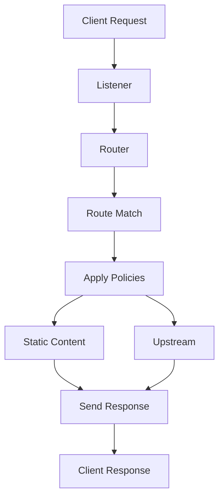

<div align="center">
  
  <br />
  <br />
  <h1>🛡️ Ophan API Gateway</h1>
  <p>
    <b>A lightweight, high-performance api gateway</b>
    <br />
    built on <a href="https://github.com/cloudflare/pingora">Cloudflare Pingora</a>
  </p>
  <p>
    
    
    
  </p>
  <br />
</div>

---

> ⚠️ **DISCLAIMER** — Ophan is under **active development**. APIs, config formats, and behavior may change without notice.  
> It is **not recommended for production use** at this stage. Feedback and contributions are welcome.

---

## 📚 Documentation

The full documentation site is hosted on GitHub Pages:

<https://zsweiter.github.io/ophan/>

---

## 📬 Feedback

Found a bug? Have a suggestion? Reach out:

📧 **zsweiter@gmail.com**

We're early-stage and every piece of feedback helps shape the roadmap.

---

## 🔥 Features

Ophan combines reverse proxy, API gateway, load balancer, and static content delivery into a single modular platform.

| Layer          | Capabilities                                       |
| -------------- | -------------------------------------------------- |
| **Protocols**  | HTTP/1.1, HTTP/2, WebSocket, gRPC                  |
| **Security**   | TLS termination, mTLS, JWT / OAuth2, WAF           |
| **Traffic**    | Rate limiting, CORS, URL rewriting, load balancing |
| **Resilience** | Health checks, circuit breaking, hot reload        |
| **Delivery**   | Static file serving,                               |
| **Transport**  | TCP, Unix Domain Sockets                           |

---

## 📦 Installation

### Linux / macOS — Quick script

```bash
# Latest release
curl -fsSL https://raw.githubusercontent.com/zsweiter/ophan/main/scripts/install.sh | sudo bash
```

```bash
# Specific version
curl -sSL https://raw.githubusercontent.com/zsweiter/ophan/main/scripts/install.sh | sudo bash -s -- --version v0.1.0
```

### Linux / macOS — Manual

```bash
# Download
VERSION="v0.1.0"
OS="linux"          # or "macos"
ARCH="x86_64"       # or "aarch64"
curl -sSL "https://github.com/zsweiter/ophan/releases/download/${VERSION}/ophan-${VERSION#v}-${OS}-${ARCH}.tar.gz" -o ophan.tar.gz

# Extract
tar -xzf ophan.tar.gz

# Install binary
sudo mv ophan-*/ophan /usr/local/bin/

# Install config
sudo mkdir -p /etc/ophan
sudo cp -r ophan-*/config/* /etc/ophan/

# Install web assets (served by the gateway on /)
sudo mkdir -p /var/www/html
sudo cp ophan-*/config/public/index.html ophan-*/config/public/favicon.svg /var/www/html/

# Install service (Linux)
# The stub contains @SBINDIR@/@CONFIGDIR@ placeholders — substitute them first
sudo sed -e 's|@SBINDIR@|/usr/local/bin|g' -e 's|@CONFIGDIR@|/etc/ophan|g' \
    ophan-*/stubs/systemd.service | \
    sudo tee /etc/systemd/system/ophan.service > /dev/null
sudo systemctl daemon-reload
sudo systemctl enable --now ophan

# Install service (macOS)
sudo sed -e 's|@SBINDIR@|/usr/local/bin|g' -e 's|@CONFIGDIR@|/etc/ophan|g' \
    ophan-*/stubs/io.ophan.ophan.plist | \
    sudo tee /Library/LaunchDaemons/io.ophan.ophan.plist > /dev/null
sudo launchctl bootstrap system /Library/LaunchDaemons/io.ophan.ophan.plist
```

### Docker

Images are built by CI and published to **GitHub Packages** (GHCR) for `linux/amd64` and `linux/arm64`:

- `ghcr.io/zsweiter/ophan:latest` — every push to `main` / `develop`
- `ghcr.io/zsweiter/ophan:<version>` — every release tag (`v1.2.3` → `1.2.3`, `1.2`)
- `ghcr.io/zsweiter/ophan:sha-<commit>` — per-commit image

```bash
# Pull
docker pull ghcr.io/zsweiter/ophan:latest

# Run with the baked-in default config (ports 80/443)
docker run -d --name ophan -p 8080:80 ghcr.io/zsweiter/ophan:latest

# Run with your own config directory
docker run -d --name ophan -p 8080:80 -p 8443:443 \
  -v /path/to/config:/etc/ophan \
  ghcr.io/zsweiter/ophan:latest
```

The `entrypoint.sh` prepares the container before the gateway starts:

1. creates the config / web / log / run directories,
2. checks that the unix socket directory (`OPHAN_SOCKET_PATH`) exists and is writable,
3. seeds the default config if the mounted `/etc/ophan` is empty,
4. runs `ophan -t` to validate the configuration,
5. execs `ophan -c <config>` (or whatever arguments you pass).

| Variable                 | Default                       | Purpose                                           |
| ------------------------ | ----------------------------- | ------------------------------------------------- |
| `CONFIG_PATH`            | `/etc/ophan/master.conf`      | Config file passed to `ophan -c`                  |
| `OPHAN_CONFIG_DIR`       | `/etc/ophan`                  | Config directory (also the seed target)           |
| `OPHAN_SKIP_CONFIG_TEST` | `0`                           | Set `1` to skip the pre-start `ophan -t` check    |
| `OPHAN_PID_FILE`         | `/var/run/ophan/ophan.pid`    | PID file (musl builds honor it)                   |
| `OPHAN_SOCKET_PATH`      | `/var/run/ophan_gateway.sock` | Unix socket the entrypoint checks for writability |
| `OPHAN_WWW_DIR`          | `/var/www`                    | Static content directory                          |

```bash
# Skip the config test (e.g. while iterating on a config)
docker run -e OPHAN_SKIP_CONFIG_TEST=1 ...

# Run an interactive shell inside the container
docker run --rm -it --entrypoint sh ghcr.io/zsweiter/ophan:latest

# Custom entrypoint arguments are forwarded to the binary
docker run --rm ghcr.io/zsweiter/ophan:latest -t -c /etc/ophan/master.conf
```

#### Volumes

| Container path   | Why                                                                                                                                    |
| ---------------- | -------------------------------------------------------------------------------------------------------------------------------------- |
| `/etc/ophan`     | `master.conf` + `gateways/*.conf`. Seeded from the image when mounted empty.                                                           |
| `/var/www`       | Static content served by `backend = static(...)`.                                                                                      |
| `/var/log/ophan` | Log files, if the config writes there.                                                                                                 |
| `/var/run/ophan` | Runtime dir: PID file **and** optional unix socket(s). Mount it (same path, or a named volume on both services) only when something outside the container must dial the socket. |

> The image chowns `/run` (=`/var/run`, including `/var/run/ophan`) to the
> `ophan` user. A **named volume** initialized from the image keeps that
> ownership; a **host bind mount** keeps the host's ownership instead — create
> it with `install -d -o <uid> -g <gid>` (see below) or start the container with
> `--user root`.

#### Networking

Two modes are supported — pick per use case:

**1. Bridge network (default)** — isolated container network, ports published explicitly:

```bash
docker run -d --name ophan \
  -p 80:80 -p 443:443 \
  -v ./config:/etc/ophan \
  ghcr.io/zsweiter/ophan:latest
```

**2. Host network** — no port publishing, the container shares the host's NICs.
**Required for XDP/eBPF filtering** (image built with `ENABLE_XDP=1`): XDP attaches
directly to a host network interface, which is meaningless behind bridge NAT.
Also convenient when the gateway should own host ports 80/443 directly:

```bash
docker run -d --name ophan \
  --network host \
  --cap-add NET_ADMIN --cap-add BPF --cap-add PERFMON \
  -v ./config:/etc/ophan \
  ghcr.io/zsweiter/ophan:latest
```

> The default CI image is built **without** XDP (`ENABLE_XDP` is unset). Treat
> `--network host` + capabilities as the "no isolation" mode; without XDP it is
> simply a shortcut for binding ports 80/443 on the host without `-p`.
>
> Host network does **not** share the filesystem: a unix socket created inside
> the container is still invisible to host processes until you bind-mount its
> directory (see below).

#### Unix domain socket

Ophan can listen on a unix socket instead of TCP — useful for traffic that must
never be reachable over the network (internal service mesh hop, sidecar proxy,
or a [Cloudflare Tunnel](https://developers.cloudflare.com/cloudflare-one/connections/connect-networks/)
origin). Add a listener to `gateways/*.conf`:

```conf
listeners {
    listener "http" {
        address   = "0.0.0.0:80"
        protocols = ["http1", "http2"]
    }

    # same path inside the container and on the host (bind-mounted dir)
    listener "uds-internal" {
        address   = "unix:/var/run/ophan/ophan_gateway.sock"
        protocols = ["http1", "http2"]   # TLS is not supported on UDS
    }
}
```

**cloudflared on bare metal** — nothing is exposed on TCP except the tunnel
itself. The socket must land on the *host* filesystem, so mount a dedicated
host directory into the container:

```bash
# 1. host directory owned by the image's ophan user
docker run --rm --entrypoint id ghcr.io/zsweiter/ophan:latest
#   uid=100(ophan) gid=101(ophan)  → use your actual output
sudo install -d -o 100 -g 101 -m 755 /var/run/ophan

# 2. run the gateway (bridge network is enough — the socket travels through
#    the bind mount, not through the network)
docker run -d --name ophan \
  -v ./config:/etc/ophan \
  -v /var/run/ophan:/var/run/ophan \
  -e OPHAN_SOCKET_PATH=/var/run/ophan/ophan_gateway.sock \
  ghcr.io/zsweiter/ophan:latest
```

```yaml
# /etc/cloudflared/config.yml (host-installed cloudflared, systemd service)
tunnel: <TUNNEL_ID>
credentials-file: /etc/cloudflared/<TUNNEL_ID>.json

ingress:
  - hostname: api.example.com
    service: unix:/var/run/ophan/ophan_gateway.sock   # HTTP over the host-visible socket
  - service: http_status:404                          # required catch-all
```

Notes:

- **Path symmetry** — the dir is mounted at the same path on both sides, so
  ophan's config and cloudflared's `service` use the identical string. If the
  paths differ, use the *container* path in ophan's config and the *host* path
  in cloudflared — they point at the same inode.
- **Permissions to connect** — pingora does not set socket permissions yet
  (`ServerAddress::Uds(addr, None)`, ophan/src/lib.rs:177), so the file is
  created with the umask (usually `0755`, owner `ophan`). The default
  cloudflared systemd unit runs as **root**, which can always connect; if you
  run cloudflared as a non-root user, run ophan with `--user root` (or the same
  uid) so the socket is writable for it.
- **Bridge vs host network** — not needed for the socket. Use `--network host`
  only if you want XDP/eBPF filtering or TCP listeners bound directly on the
  host without publishing ports.
- If the mounted directory is not writable by the container user, the
  entrypoint warns before start (`OPHAN_SOCKET_PATH` is only a preflight hint —
  the listener in the config always decides where the socket is created).

> If the proxy were a container instead, share the directory with a named
> volume (`-v ophan-run:/var/run/ophan` on **both** services) and point
> cloudflared at `unix:/var/run/ophan/ophan_gateway.sock`.

#### Building the image locally

```bash
# Single-arch, loaded into the local daemon
make package-docker

# Multi-arch, pushed to GitHub Packages (same flow as CI)
docker buildx build --platform linux/amd64,linux/arm64 \
  -t ghcr.io/zsweiter/ophan:latest --push .
```

### Verify checksums

Every release includes SHA256 checksums:

```bash
# After downloading a package
sha256sum -c ophan-*.tar.gz.sha256

# Or download the matching checksum for the exact package, e.g.
curl -sSL https://github.com/zsweiter/ophan/releases/download/v0.1.0/ophan-v0.1.0-linux-x86_64.tar.gz.sha256
```

---

## 🗑️ Uninstall

### Linux (systemd)

```bash
sudo systemctl stop ophan
sudo systemctl disable ophan
sudo rm -f /etc/systemd/system/ophan.service
sudo rm -f /usr/local/bin/ophan
sudo rm -rf /etc/ophan
sudo rm -rf /var/log/ophan
sudo rm -f /run/ophan.pid
# Remove the web assets only if no other site is using /var/www/html
sudo rm -f /var/www/html/index.html /var/www/html/favicon.svg
sudo systemctl daemon-reload
```

### macOS (LaunchDaemon)

```bash
sudo launchctl bootout system /Library/LaunchDaemons/io.ophan.ophan.plist
sudo rm -f /Library/LaunchDaemons/io.ophan.ophan.plist
sudo rm -f /usr/local/bin/ophan
sudo rm -rf /etc/ophan /var/log/ophan /var/run/ophan.pid
```

### Windows

```powershell
# Remove the service (the stub script supports install | uninstall | status)
.\stubs\windows-service.ps1 -Action uninstall
```

---

## 🏗️ High-Level Architecture



---

## 🔁 Middleware Pipeline

```
request
  → tls termination
  → cors
  → waf
  → rate limit
  → auth (oauth2 / jwt)
  → rewrite
  → route
  → static / upstream proxy
  → response
```

---

## 🧭 Vision

- **Simplicity** — Declarative config, minimal moving parts
- **Performance** — Allocation-free routing, lock-free hot path, upstream connection reuse by default
- **Hot Reload** — Atomic config swap without dropping connections
- **Modular** — Plug policies, backends, and protocols

---

## 🛠️ Development

```bash
make fmt
make lint
make test
make run
```

### CI pipeline

```bash
make ci          # fmt → lint → test → package (auto-detect OS)
make package-all # Build + package for Linux, macOS, Windows
make package-docker  # Build Docker image (musl)
make checksum    # Generate SHA256 checksums
```

### GitHub workflows

| Workflow        | Trigger                           | What it does                                   |
| --------------- | --------------------------------- | ---------------------------------------------- |
| `ci.yml`        | push / PR                         | fmt → clippy → tests (4 targets)               |
| `release.yml`   | tag `vX.Y.Z`                      | release tarballs/zips + SHA256 checksums       |
| `docker.yml`    | push to `main`/`develop`, tag, PR | multi-arch image → GitHub Packages (`ghcr.io`) |
| `docs-site.yml` | push to `docs/public`             | deploys the documentation site                 |

---

## 📄 License

MIT
